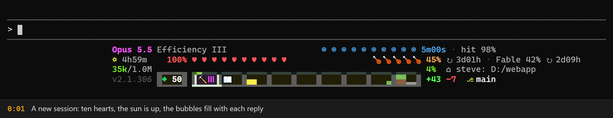
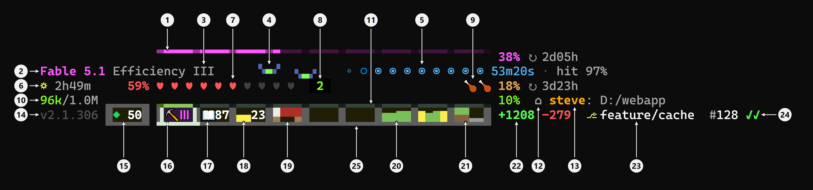
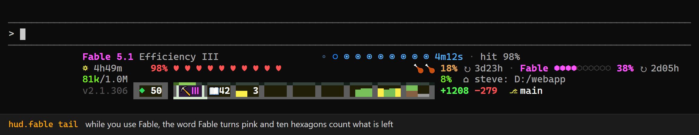
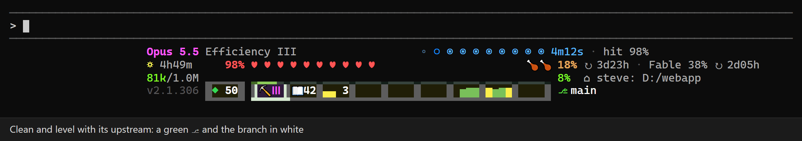
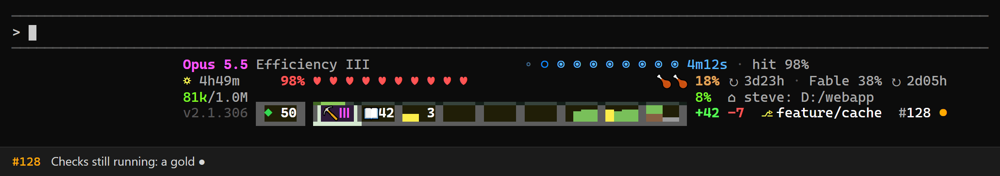
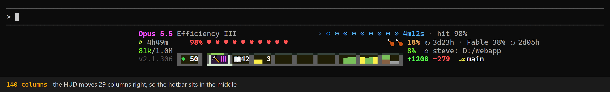
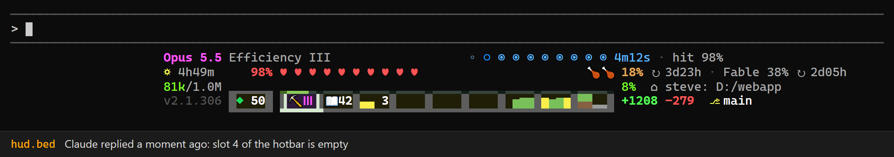
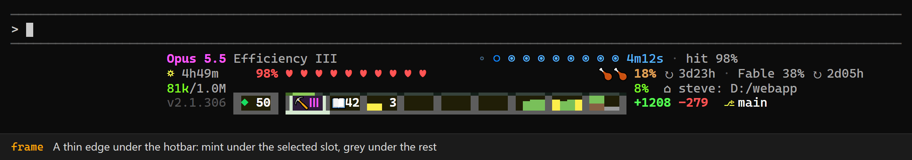
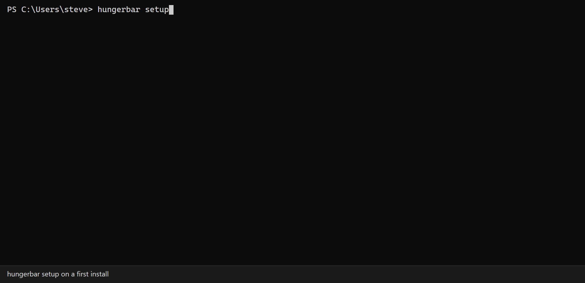
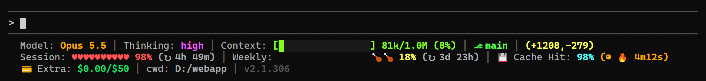

<p align="center">
  
</p>

# Hungerbar

**Your Claude Code limits as a Minecraft HUD, right in the status line.**

[](LICENSE)
[](https://github.com/DandelionBold/hungerbar/releases/tag/v1.0.0)
[](https://nodejs.org/)
[](#requirements)
[](https://github.com/DandelionBold/hungerbar/actions/workflows/ci.yml)

Hearts are your 5-hour window. Drumsticks are your week. The XP bar is your context. The last two hours of git grow as terrain in the hotbar.

**Quick start.** With Claude Code and Node.js 20 or newer, run these two commands in a terminal, one after the other, and answer setup's questions (Enter takes each default):

```bash
npm i -g https://github.com/DandelionBold/hungerbar/releases/download/v1.0.0/hungerbar-1.0.0.tgz
hungerbar setup
```

[Install](#install) has the requirements, what to type if PowerShell says running scripts is disabled, and what setup changes.

- [What it is](#what-it-is)
- [Anatomy](#anatomy)
- [Features](#features)
- [Install](#install)
- [Configuration](#configuration)
- [Commands](#commands)
- [The classic look](#the-classic-look)
- [Privacy and network](#privacy-and-network)
- [How it stays fast](#how-it-stays-fast)
- [Troubleshooting](#troubleshooting)
- [Uninstall and rollback](#uninstall-and-rollback)
- [Contributing](#contributing), [License](#license), [Trademarks](#trademarks)

## What it is

Claude Code can run a command of your choice to draw a status line under its prompt. Hungerbar is that command. On each render, Claude Code passes it the model, the context, the cost, your 5-hour and weekly limits and the prompt cache. Hungerbar adds your git state and draws it all as Minecraft's HUD:

- **Hearts** show what is left of the 5-hour window. **Drumsticks** show what is left of the week.
- The **XP bar** is the context. The **level** counts the times it was compacted.
- **Air bubbles** are the prompt cache. They pop as it cools.
- The **hotbar** holds the thinking effort, your prompts, the session's cost and the last two hours of git as terrain.
- The **branch** shows what git is doing. It can also show the pull request and its checks.

Hungerbar is one JavaScript file with no runtime dependencies. It never uses the network while it draws, and it runs git only in the background (unless you set `git.mode` to `sync`). Its network features stay off until you say yes.

In plain text, a normal day looks like this (at the left edge, without your name or colours):

```
Opus 5.5 Efficiency III                   ◦ ○ ◉ ◉ ◉ ◉ ◉ ◉ ◉ ◉ 4m12s · hit 98%
☼ 4h49m     98% ♥ ♥ ♥ ♥ ♥ ♥ ♥ ♥ ♥ ♥                       🍗🍗 18% ↻ 3d23h
81k/1.0M ▂▂▂▂▂▂ ▂▂▂▂▂▂▂▂▂▂▂▂▂▂▂▂▂▂▂▂▂▂▂▂▂▂▂▂▂▂▂▂▂▂▂▂▂▂▂▂▂▂▂▂▂▂ 8%  ⌂ D:/webapp
v2.1.306  ◆ 50  ▐⛏ Ⅲ ▌📖42 ▄▄ 3                 ▅▆▆ ▆▅▆▆ ▀▀▂▂  +1208 -279  ⎇ main
⠀⠀⠀⠀⠀⠀⠀⠀⠀🮂🮂🮂🮂🮂🮂⠀🮂🮂🮂🮂🮂🮂🮂🮂🮂🮂🮂🮂🮂🮂🮂🮂🮂🮂🮂🮂🮂🮂🮂🮂🮂🮂🮂🮂🮂🮂🮂🮂🮂🮂🮂🮂🮂🮂🮂🮂🮂🮂🮂🮂🮂🮂
```

## Anatomy



This is one render. The Claude Code session is about four and a half hours old and the context was compacted twice. Those are two signs of a long session, so two phantoms fly in the sky. Fable is in use, so the boss bar shows. Nobody has written for about 7 minutes, so the bed is out. The branch has changes and an approved pull request. Claude Code runs as Administrator, so the name is gold.

| # | Part | What it shows | In Minecraft |
|---|---|---|---|
| 1 | Boss bar | Fable's weekly limit while you use Fable (`hud.fable boss`, the default). It shows a pink bar as wide as the hotbar, right over it, that gets shorter as you use Fable, then the % left and ↻ when it is full again. It has no name of its own: the line below already names the model in use. The bar and the % turn red at 10% or less. It needs the usage API. | The boss bar at the top of the screen, showing a boss's health. |
| 2 | Item in your hand | The model, in its rarity colour: light purple for Opus and Fable, aqua for Sonnet, yellow for Haiku. | The name of the held item, coloured by its rarity: epic is light purple, rare is aqua, uncommon is yellow. |
| 3 | Enchantment | The thinking effort, from `Efficiency I` (low) to `V` (max). | An enchantment on a tool. Efficiency makes a tool dig faster, from level I to V. |
| 4 | Phantoms | A long session (`hud.phantoms`). There is one phantom for each sign: 100 or more prompts, 4 hours or more, 2 or more compactions, context at 70% or more. With one sign, a small dim phantom flies far away. With two or more, that many big ones fly with green eyes. They hint that `/clear` would help. | Flying undead mobs with green eyes. They come at night for a player who has not slept for days. |
| 5 | Air bubbles | The prompt cache. There are ten bubbles, all full right after Claude Code writes the cache, and they pop one by one as its time runs out. Then come the time left and the hit ratio. When the cache has expired, the bubbles are empty and `cold` shows. | The breath meter over the hunger bar. Its bubbles pop while you stay underwater. |
| 6 | Day and night | The 5-hour window as one Minecraft day: ☼ yellow, then orange for dusk after 3 hours, ☾ in the last hour, and ☠ once it is used up. Then come the time to its reset and the % left. | The day: the sun, dusk and the moon, as a clock shows them. The skull stands for dying, and a new window is a respawn. |
| 7 | Hearts | What is left of the 5-hour window, as ten hearts. A lost heart turns dark, from the right. | Health: ten hearts. |
| 8 | Level | How many times the context was compacted, as a green number in a black box. There is no box before the first compaction. | The experience level: the green number over the XP bar. |
| 9 | Drumsticks | What is left of the week, as ten drumsticks. An eaten one vanishes from the left. Then come the % left and ↻ the time to its reset. The % turns red at 10% or less. | Hunger: ten drumsticks. Food refills your hearts, as the week refills each 5-hour window. |
| 10 | Context tokens | The tokens in the context and the size of the window, such as `96k/1.0M`. The number is green under 50%, yellow under 80% and red after that. | No counterpart. Minecraft shows only the level. |
| 11 | XP bar | How full the context is. Its notches sit over the hotbar's dividers, and the % used comes after it. `/compact` drains most of it and adds a level. | The experience bar, which fills as you collect experience. |
| 12 | Spawn point | ⌂ and the folder Claude Code runs in. A long path is cut from the front. | Your spawn point: home, where you come back to. |
| 13 | Operator | Your user name before the folder (`hud.user`). While Claude Code runs as Administrator (root elsewhere), the name turns bold gold (`hud.op gold`, the default). With `tag`, a red `[OP]` shows instead. | An operator: a player with admin rights on a server. Servers often show it as a coloured name or an `[OP]` rank in chat. |
| 14 | Version | Claude Code's version, in dark grey. | The version in the corner of the title screen. |
| 15 | Offhand | ◆ The extra credits left, in whole dollars, when the account has extra usage. Its frame turns green while a limit is used up and the extra credits pay. | The offhand slot, holding an emerald, the villagers' money. |
| 16 | Pickaxe | The selected slot, in the mint selection frame. The pickaxe takes its colour from the model's family. The effort shows as a numeral (Ⅰ to Ⅴ) on a glint that turns a deeper purple with more effort. | The selected hotbar slot, holding a pickaxe. Enchanted items shimmer with a purple glint. |
| 17 | Book and quill | 📖 The prompts you sent this session, typed or sent while Claude was working. Slash commands, interrupts and notifications do not count. 100 or more shows 99 in yellow. | The book and quill, a book you write in. |
| 18 | Gold | The session's cost, in whole dollars. | A gold ingot. |
| 19 | Bed | After 5 minutes without a message, a bed lies in the empty slot (`hud.bed`). It has a white pillow and a red blanket on oak legs. It goes away with your next message. It never shows while a tool is still running. | A bed, where you sleep through the night. |
| 20 | Terrain | The last two hours of git, one column per quarter hour. Each column is as high as the diff got then. It is green when at least as many lines were added as removed, grey when more were removed, and gold where you committed. A quarter hour with no diff is flat brown ground. | The land: hills of grass and stone, with gold. |
| 21 | Grass and cobblestone | The lines added (grass) and removed (cobblestone) now. The smaller count is a slab, sized by its share. | A grass block and a cobblestone block. A slab is a part of a block. |
| 22 | Counts | The exact `+added -removed`, in green and red. | Like the count on a stack of items. |
| 23 | Branch | ⎇ is coloured by your files: green when clean, yellow when changed, aqua when only new untracked files exist, red with a conflict. The branch is coloured by its commits: white, purple during a merge, rebase or cherry-pick, gold when ahead of or behind its upstream, grey `@sha` on a detached HEAD. Short marks follow it, such as `merge`, `!2`, `?3` and `↑2↓1`. | The chat colours: green, yellow, aqua, red, purple and gold. |
| 24 | Pull request | The branch's pull request (`hud.pr`, with your own `gh`). It shows `#128`, then the checks: gold ● still running, green ✓ passed, red × failed. At most one more mark follows: ✓ approved, ± changes requested, ‼ a conflict, ◌ a draft. A merged PR shows in purple and a closed one in dark grey. | No counterpart. It uses the chat colours too. |
| 25 | Hotbar frame | A thin edge under the hotbar: mint under the selected slot, grey under the rest. The offhand gets an edge under and over it, green while the extra credits pay. | The frame of the hotbar, and the box around the selected slot. |

## Features

### Fable's weekly limit



Fable has its own weekly limit. `hud.fable` picks how the HUD shows it:

| Option | While you use another model | While you use Fable |
|---|---|---|
| `off` | nothing | nothing |
| `tail` | a grey note after the weekly food: `Fable 65% ↻ 4d00h` | the word Fable turns pink and ten hexagons count what is left |
| `tooltip` | the same note | line 1 shows Fable's wear, like a tool's: `Fable 5.1 Eff III █▉ 38% ↻ 2d05h` |
| `boss` (the default) | the same note | a sixth line on top: a boss bar as wide as the hotbar, the % left and when it is full again |
| `beacon` | a beacon at the end of the food line, `◈ Fable 65% ↻ 4d00h`, with a beam into the line above | the same, with Fable in pink |

The % turns red at 10% left or less. A used-up Fable says when it is back: `Fable 0% ↻ 19h00m` in the grey note, or `0% ↻ 19h00m` at the end of the boss bar. Fable 5.1 in use with `boss`:

```
⠀⠀⠀⠀⠀⠀⠀⠀⠀⠀⠀⠀⠀⠀⠀⠀🮂🮂🮂🮂🮂🮂🮂🮂🮂🮂🮂🮂🮂🮂🮂🮂🮂🮂🮂🮂🮂🮂🮂🮂🮂🮂🮂🮂🮂🮂🮂🮂🮂🮂🮂🮂🮂🮂🮂🮂🮂🮂🮂🮂🮂🮂 38% ↻ 2d05h
Fable 5.1 Efficiency III                  ◦ ○ ◉ ◉ ◉ ◉ ◉ ◉ ◉ ◉ 4m12s · hit 98%
☼ 4h49m     98% ♥ ♥ ♥ ♥ ♥ ♥ ♥ ♥ ♥ ♥                       🍗🍗 18% ↻ 3d23h
81k/1.0M ▂▂▂▂▂▂ ▂▂▂▂▂▂▂▂▂▂▂▂▂▂▂▂▂▂▂▂▂▂▂▂▂▂▂▂▂▂▂▂▂▂▂▂▂▂▂▂▂▂▂▂▂▂ 8%  ⌂ D:/webapp
v2.1.306  ◆ 50  ▐⛏ Ⅲ ▌📖42 ▄▄ 3                 ▅▆▆ ▆▅▆▆ ▀▀▂▂  +1208 -279  ⎇ main
⠀⠀⠀⠀⠀⠀⠀⠀⠀🮂🮂🮂🮂🮂🮂⠀🮂🮂🮂🮂🮂🮂🮂🮂🮂🮂🮂🮂🮂🮂🮂🮂🮂🮂🮂🮂🮂🮂🮂🮂🮂🮂🮂🮂🮂🮂🮂🮂🮂🮂🮂🮂🮂🮂🮂🮂🮂🮂🮂🮂🮂🮂
```

The numbers come from the usage API, which uses the network. So every option but `off` shows nothing until you turn the usage API on. `hungerbar setup` asks you, or run `hungerbar look hud --fable boss`. Both say first what the usage API reads and sends (see [Privacy and network](#privacy-and-network)).

### Git state



⎇ and the branch say what git is doing. Short marks follow the branch:

| | Shows |
|---|---|
| ⎇ | your files: green when clean, yellow when changed, aqua when the only changes are new files git does not track yet, red with a conflict (grey until the first background `git status` has answered) |
| the branch | your commits: white, purple during a merge, rebase or cherry-pick, gold when ahead of or behind its upstream; `@4f4e2d8` in grey on a detached HEAD |
| `merge`, `rebase 2/5`, `pick` | in purple: what is in progress (a rebase shows the branch it is rebasing, as git's prompt does) |
| `!2` | in red: 2 files with a conflict |
| `?3` | in aqua: 3 new files, as `git status` lists them (a new folder counts once) |
| `↑2↓1` | in gold: 2 commits to push and 1 to pull |

A clean branch level with its upstream has no marks. A long branch is cut from the front (`…/minecraft-hud-round-4 merge !2`). The counts come from a background `git status --porcelain=v2 --branch`. What is in progress is read from the files git keeps in `.git`, so the status line itself never runs git (unless you set `git.mode` to `sync`, which runs it inline). A merge you abort is gone on the next render, and the counts follow a few seconds later.

### Pull request and CI



With `hud.pr` on, the branch's pull request follows the git state:

| | Shows |
|---|---|
| `#123` | the PR's number; grey with a grey ◌ while it is a draft |
| ● ✓ × | its checks: gold ● still running, green ✓ all passed, red × one failed (no mark when the PR has no checks) |
| ✓ ± ‼ ◌ | at most one more: a second green ✓ approved (✓✓ is ready to merge), yellow ± changes requested, red ‼ a conflict with its base branch, grey ◌ a draft |
| `#123 merged` | in purple once it is merged; `#123 closed` in dark grey once it is closed |

A branch with no pull request shows nothing extra. The status comes from your own GitHub CLI, so you need [`gh`](https://cli.github.com) installed and logged in (`gh auth login`); without `gh`, nothing shows. Asking `gh` uses the network, so the status is off until you say yes: `hungerbar setup` asks when it finds `gh`, or run `hungerbar look hud --pr on`. The details are in [Privacy and network](#privacy-and-network).

### Centred like Minecraft's hotbar



By default (`hud.align: center`) the whole HUD moves right as one block, so the hotbar sits in the middle of the status line. The normal day, centred in a 120-column window:

```
⠀⠀⠀⠀⠀⠀⠀⠀⠀⠀⠀⠀⠀⠀⠀⠀⠀⠀⠀Opus 5.5 Efficiency III                   ◦ ○ ◉ ◉ ◉ ◉ ◉ ◉ ◉ ◉ 4m12s · hit 98%
⠀⠀⠀⠀⠀⠀⠀⠀⠀⠀⠀⠀⠀⠀⠀⠀⠀⠀⠀☼ 4h49m     98% ♥ ♥ ♥ ♥ ♥ ♥ ♥ ♥ ♥ ♥                       🍗🍗 18% ↻ 3d23h
⠀⠀⠀⠀⠀⠀⠀⠀⠀⠀⠀⠀⠀⠀⠀⠀⠀⠀⠀81k/1.0M ▂▂▂▂▂▂ ▂▂▂▂▂▂▂▂▂▂▂▂▂▂▂▂▂▂▂▂▂▂▂▂▂▂▂▂▂▂▂▂▂▂▂▂▂▂▂▂▂▂▂▂▂▂ 8%  ⌂ D:/webapp
⠀⠀⠀⠀⠀⠀⠀⠀⠀⠀⠀⠀⠀⠀⠀⠀⠀⠀⠀v2.1.306  ◆ 50  ▐⛏ Ⅲ ▌📖42 ▄▄ 3                 ▅▆▆ ▆▅▆▆ ▀▀▂▂  +1208 -279  ⎇ main
⠀⠀⠀⠀⠀⠀⠀⠀⠀⠀⠀⠀⠀⠀⠀⠀⠀⠀⠀⠀⠀⠀⠀⠀⠀⠀⠀⠀🮂🮂🮂🮂🮂🮂⠀🮂🮂🮂🮂🮂🮂🮂🮂🮂🮂🮂🮂🮂🮂🮂🮂🮂🮂🮂🮂🮂🮂🮂🮂🮂🮂🮂🮂🮂🮂🮂🮂🮂🮂🮂🮂🮂🮂🮂🮂🮂🮂🮂🮂🮂🮂
```

- **How far.** The width is `HUNGERBAR_WIDTH`, or the `COLUMNS` Claude Code passes, minus 4 and `widthReserve` (116 above). The hotbar's centre column (39) moves to the middle of it, `floor(width / 2) - 39` columns right, but never so far that the widest line would pass the edge.
- **Padding.** Hungerbar does not read the `padding` of Claude Code's `statusLine`, `COLUMNS` is the full width, and Claude Code puts the padding on both sides of the status line. So with a padding the centre sits that many columns right of the middle, and a line can end up to twice that past the edge, where Claude Code cuts it with `…`. Setup writes `"padding": 0`; if you keep another, set `widthReserve` to twice it (padding 3 needs `"widthReserve": 6`; `hungerbar doctor` warns until you do).
- **It follows the window.** Claude Code passes `COLUMNS` on every run and re-runs the status line on its events and every `refreshInterval` (10 s). After a resize, the next render is centred again.
- **When it stays left.** With an unknown width (no `COLUMNS`, as when you run `hungerbar` by hand) or no room to move, the HUD stays at the left edge.
- **Why not spaces.** Claude Code trims the spaces at the start of every status line. So the shift is made of U+2800 (braille pattern blank), which is not a space and draws nothing.

`hungerbar look hud --align left` puts the HUD at the left edge.

### The bed and the phantoms



- **The bed** (`hud.bed`). After 5 minutes without a message, a bed lies in the empty hotbar slot 4. It goes with your next message. The time counts from the transcript's last message (a tool's result counts) or the prompt cache's last write. While Claude is still working, there is no bed, however long it takes: a tool call without its result (a long build, a test run, a subagent) keeps it away. A question for you (`AskUserQuestion`, `ExitPlanMode`) waits on you, so the bed comes. A permission prompt looks the same as a running tool, so it gets no bed.
- **The phantoms** (`hud.phantoms`). Phantoms gather in line 1's empty sky, one for each sign of a long session: 100 or more prompts, 4 hours or more, 2 or more compactions, and the context at 70% or more. One sign brings one small, dim phantom far away. Two or more bring that many big ones with green eyes, a hint that `/clear` would help. A fresh session has a clear sky.

Both are on by default. `hungerbar look hud --bed off --phantoms off` turns them off.

### Your name and the operator's mark

- **Your name** (`hud.user`) goes between ⌂ and the folder, in the folder's grey: `⌂ steve: D:/webapp` with `user` (the default), `⌂ steve@DESKTOP: D:/webapp` with `user@host`, or the folder alone with `off`.
- **The operator's mark** (`hud.op`) shows only while Claude Code runs elevated: as Administrator on Windows, or as root elsewhere. With `gold` (the default) your name turns bold gold. With `tag` a bold red `[OP]` comes before your name. With `off` nothing shows. When Claude Code runs normally, nothing changes.

The names come from the system (`os.userInfo`, `os.hostname`). On Windows, the elevation check is whether Hungerbar may open `%SystemRoot%\System32\config\systemprofile`, which only an elevated process may. None of this starts a process or uses the network. When line 3 runs out of room, the folder is cut from the front but keeps at least 10 columns; until it can, the host goes first, then the name, then the `[OP]` tag.

### The hotbar's frame



A thin edge runs under the hotbar: mint under the selected slot (the pickaxe), grey under the rest, like the bottom of Minecraft's hotbar. When your account has extra usage, the offhand ◆ shows the extra credits left, in whole dollars. It is framed too, and its frame turns green while a limit is used up and the extra credits pay. The row's empty cells are U+2800, a blank that Claude Code does not trim, so the edge stays under the hotbar.

### Two icon styles

Hungerbar prints the same text in both styles; your terminal decides how 🍗 🔥 💾 💳 ❄ look.

- **colour**: colour emoji, Windows Terminal's default.
- **plain**: plain glyphs in Hungerbar's colours. The switch keeps your font first and puts `Segoe UI Symbol` right after it (`Cascadia Mono, Segoe UI Symbol` with Windows Terminal's default font). This applies to every program in the terminal.

```bash
hungerbar icons          # which style is on
hungerbar icons plain    # or: hungerbar icons colour
```

The switch changes only the font face in Windows Terminal's profile defaults (`profiles.defaults` in its `settings.json`), which every profile without its own font face uses. A profile with its own face is listed, not changed. The switch makes a backup next to the file first and keeps every other byte, comments included. In other terminals, plain icons need the terminal to fall back to a plain symbol font before its emoji font.

## Install

### Requirements

- **Claude Code.**
- **Node.js 20 or newer.**
- **Windows Terminal** is recommended. The HUD needs 256 or 24-bit colour, and its glyphs and widths were checked in Windows Terminal. In another terminal, `hungerbar glyphs --hud` shows whether each glyph has the right width.
- **Git for Windows**, on Windows. Claude Code runs status lines through its Git Bash, and the command `setup` writes is made for it.
- Optional: **git** for the git state and the terrain, and the **GitHub CLI** (`gh`), logged in, for the pull request status.

Hungerbar is built and tested on Windows. `setup` also writes a command for macOS and Linux, but those are not tested.

### Install from the release

```bash
npm i -g https://github.com/DandelionBold/hungerbar/releases/download/v1.0.0/hungerbar-1.0.0.tgz
hungerbar setup
```

Hungerbar is not on the npm registry, so npm installs it from the release's tarball. The two commands are on two lines because Windows PowerShell 5.1 has no `&&`; in another shell you can join them with `&&`.

If Windows PowerShell says `npm.ps1` or `hungerbar.ps1` cannot be loaded because running scripts is disabled on this system, its execution policy blocks the `.ps1` scripts that Node.js and npm put on your `PATH`. Type `npm.cmd` and `hungerbar.cmd` instead, here and for every `hungerbar` command in this README; they do the same. Command Prompt and Git Bash are not affected.

### What `hungerbar setup` does



In a terminal, `setup` asks a few questions. Each answer is shown as a preview drawn with your own names. Each question pre-selects the default, so Enter accepts it:

1. **The look:** the Minecraft HUD (the default) or the classic lines. Classic ends the questions here.
2. **Fable's weekly limit:** a boss bar (the default), another option, or none. For any option but none, setup then says what the usage API reads and sends, and asks `Turn on the usage API? [Y/n]`. If no, the option becomes none and the no is saved (`"usageApi": false`).
3. **Where it sits:** centred (the default) or at the left edge.
4. **Your name:** your user name (the default), `user@host`, or none.
5. **The operator's mark:** your name in gold (the default), a red `[OP]`, or nothing.
6. **The pull request status**, only when `gh` is found: setup says what it runs and sends, and asks `Show the pull request status? [Y/n]`.

If you already have a `hungerbar.json`, Enter keeps what it has. The two network questions pre-select yes unless the file sets the key they ask about; then Enter keeps the file's value. The pull request question's key is `hud.pr`. The usage API question's key is `network.usageApi`; when the usage API is on already, setup asks about `network.scopedWeekly` (Fable's weekly) instead. Each no is saved, so the next setup keeps it: a no to the pull request status as `"pr": "off"`, a no to the usage API as `"usageApi": false` (or `"scopedWeekly": false`).

Flags answer for setup: `--look classic|hud`, then, for the HUD, `--fable off|tail|tooltip|boss|beacon`, `--align left|center`, `--user off|user|user@host`, `--op off|tag|gold`, `--pr on|off`, `--bed on|off` and `--phantoms on|off`. The HUD's flags go with `--look hud`, for example `hungerbar setup --look hud --fable boss --pr on`. Without a terminal, setup asks nothing. Whenever it asks nothing (no terminal, or flags), it prints what of the HUD still waits for your yes, such as `hungerbar look hud --fable boss --pr on`. The pull request status is named only when `gh` is found, and a no you already gave (such as `"pr": "off"`) is not named again.

Then setup backs up `~/.claude/settings.json` to `settings.json.bak.<timestamp>`, remembers your old `statusLine`, and changes only that key:

```json
"statusLine": {
  "type": "command",
  "command": "\"C:/Program Files/nodejs/node.exe\" \"C:/Users/<you>/AppData/Roaming/npm/node_modules/hungerbar/dist/hungerbar.mjs\"",
  "padding": 0,
  "refreshInterval": 10
}
```

The command names `node.exe` and the bundle by their full paths, never through an npm shim. A `padding` or `refreshInterval` you already had is kept. Claude Code picks the new command up on its next render.

- `hungerbar setup --print` shows what would change and writes nothing.
- `hungerbar setup --icons plain` (or `colour`) also switches the [icon style](#two-icon-styles), as `hungerbar icons` does.
- `hungerbar setup --launcher` writes a `statusline.cmd` launcher instead. It is slower; keep it for setups where the direct command misbehaves.
- On macOS and Linux the command is `'<node>' '<npm root>/hungerbar/dist/hungerbar.mjs'`.

### Upgrade

Install the newer release the same way: `npm i -g <the new release's .tgz URL>`. The install path stays the same, so `settings.json` needs no change. If Node moves to a new folder, run `hungerbar setup` again, because the command names `node.exe` by its full path.

## Configuration

Settings live in `~/.claude/hungerbar.json` (`HUNGERBAR_CONFIG` names another file; `CLAUDE_CONFIG_DIR` moves `~/.claude`). Every key is optional. When `setup` or `look` creates the file, it adds a `$schema` link to [`schema.json`](schema.json), so your editor can complete and check keys. `hungerbar look` changes the look's keys for you, with a backup.

The file is strict JSON. Unknown keys are ignored, and a value that is not allowed falls back to its default (except `hud.fable`, which falls back to `off`). A file that is not valid JSON draws the classic lines with a dim `cfg!` until you fix it.

**The look and the HUD**

| Key | Default | Values | What it does |
|---|---|---|---|
| `look` | `hud` | `hud`, `classic` | the Minecraft HUD, or the [classic lines](#the-classic-look) |
| `hud.fable` | `boss` | `off`, `tail`, `tooltip`, `boss`, `beacon` | how the HUD shows [Fable's weekly limit](#fables-weekly-limit); every option but `off` needs `network.usageApi` and `network.scopedWeekly` |
| `hud.align` | `center` | `center`, `left` | the hotbar in the middle of the status line, or the HUD at the left edge |
| `hud.minWidth` | `80` | 62 to 200 | the HUD draws only when a known width leaves this many columns; otherwise the classic lines draw |
| `hud.pr` | `off` | `off`, `on` | the branch's [pull request and CI](#pull-request-and-ci), through your own `gh` (uses the network) |
| `hud.user` | `user` | `off`, `user`, `user@host` | [your name](#your-name-and-the-operators-mark) before the folder |
| `hud.op` | `gold` | `off`, `tag`, `gold` | the mark while Claude Code runs as Administrator (root elsewhere) |
| `hud.bed` | `on` | `on`, `off` | the [bed](#the-bed-and-the-phantoms) after 5 minutes without a message |
| `hud.phantoms` | `on` | `on`, `off` | the phantoms of a long session |

**Both looks**

| Key | Default | Values | What it does |
|---|---|---|---|
| `icons` | `minecraft` | `minecraft`, `unicode`, `ascii` | `unicode`: plain numbers for the limits in the classic lines; `ascii`: no Unicode at all, which also keeps the HUD off |
| `color` | `auto` | `auto`, `always`, `never` | `never` turns colour off, which also keeps the HUD off |
| `colorDepth` | `auto` | `auto`, `truecolor`, `256`, `16` | `auto` picks 24-bit in Windows Terminal, VS Code and terminals that set `COLORTERM`, else 256; `16` keeps the HUD off |
| `bold` | `true` | `true`, `false` | bold values (labels stay regular) |
| `nbsp` | `true` | `true`, `false` | inner spaces as U+00A0, so Claude Code keeps them |
| `widthReserve` | `0` | 0 to 200 | columns to leave free when the width is known; set it to twice a non-zero `statusLine.padding` |
| `git.mode` | `swr` | `swr`, `sync`, `off` | `swr`: git runs in the background; `sync`: inline, slower; `off`: no git commands (the branch and a merge, rebase or cherry-pick in progress still show, read from `.git`) |
| `git.ttlSeconds` | `15` | 1 to 3600 | how long a git answer counts as fresh |
| `git.timeoutMs` | `2000` | 100 to 30000 | a background git run is stopped after this |
| `network.usageApi` | `false` | `true`, `false` | the [usage API](#privacy-and-network): extra credits and per-model weekly limits (uses the network) |
| `network.scopedWeekly` | `false` | `true`, `false` | per-model weekly limits such as Fable's, for `hud.fable` and the `scopedWeek` item |
| `network.ttlSeconds` | `180` | 60 to 86400 | how often the usage API is asked while a session renders |

**The classic look only**

| Key | Default | Values | What it does |
|---|---|---|---|
| `lines` | 3 lines | up to 3 lists of item ids | which items each line shows: `model`, `effort`, `context`, `git`, `limit5h`, `limitWeek`, `scopedWeek`, `cache`, `extra`, `cwd`, `version`; the default is `[["model","effort","context","git"],["limit5h","limitWeek","cache"],["extra","cwd","version"]]` |
| `bar.width` | `16` | 4 to 40 | the context bar's cells |
| `thresholds.warn` / `thresholds.crit` | `75` / `90` | 1 to 100 | the % used at which limits, context and extra turn yellow and red |
| `limits` | `left` | `left`, `used` | whether the icons and the % count what is left or what is used |
| `minecraft.session` / `minecraft.weekly` | `hearts` / `food` | `hearts`, `food` | which bar each limit shows |

For example, the full setup with both network features on:

```json
{
  "network": { "usageApi": true, "scopedWeekly": true },
  "hud": { "pr": "on" }
}
```

**Environment variables** win over the file:

| Variable | Effect |
|---|---|
| `HUNGERBAR_LOOK=classic\|hud` | the look, for this environment |
| `HUNGERBAR_HUD_ALIGN=left\|center` | where the HUD sits |
| `HUNGERBAR_ICONS=minecraft\|unicode\|ascii`, `HUNGERBAR_ASCII=1` | the icons; ASCII mode also keeps the HUD off (as does `TERM=dumb`) |
| `NO_COLOR`, `FORCE_COLOR` | no colour, or a forced depth (`FORCE_COLOR=0` keeps the HUD off, `1` keeps it off too unless `colorDepth` is `256` or `truecolor`, `2` is 256 colours, `3` is 24-bit) |
| `HUNGERBAR_WIDTH` | the width to fit and centre in, instead of `COLUMNS` |
| `HUNGERBAR_USAGE_API=1` | turns the usage API on, even where the file sets it to `false` |
| `HUNGERBAR_OFFLINE=1`, `CLAUDE_CODE_DISABLE_NONESSENTIAL_TRAFFIC` | turns everything that uses the network off |
| `HUNGERBAR_CONFIG`, `HUNGERBAR_CACHE_DIR` | another config file, another cache folder |
| `HUNGERBAR_DEBUG=1` | phase timings on stderr |
| `HUNGERBAR_CAPTURE=<dir>` | saves one payload per Claude Code version, with the working and project folders, the transcript path and the session id replaced; other paths, such as a worktree's, are kept, so read it before you share it |

## Commands

```
hungerbar                      render from stdin (in a terminal it shows a demo)
hungerbar setup                switch Claude Code's status line to Hungerbar (a terminal asks for the look)
hungerbar setup --restore      put the previous status line back
hungerbar look [classic|hud]   show or switch the look; --fable, --align, --pr, --user, --op, --bed,
                               --phantoms; --print shows the change and writes nothing
hungerbar preview              draw sample situations (normal, tight, fresh, extra, fable); writes nothing
hungerbar doctor [--bench]     check the install and time a render
hungerbar glyphs [--hud]       a width ruler for the icons, to check your terminal's font
hungerbar icons [plain|colour] show or switch the icon style (a Windows Terminal font setting)
hungerbar --help, --version
```

A few examples:

```bash
hungerbar look                                  # the look, its options, and whether this terminal draws the HUD (or why not)
hungerbar look hud --fable boss --pr on         # the boss bar and the PR status (each says first what it uses)
hungerbar preview --look hud --situation all    # every sample situation in the HUD
hungerbar preview --align center --width 120    # the HUD centred in a 120-column window
```

`look` changes only `hungerbar.json`, after a backup next to it (`hungerbar.json.bak.<timestamp>`), and keeps every other key in its place. Each change prints the way back. Claude Code draws the new look on its next render.

## The classic look



`hungerbar look classic` draws three lines instead, the look Hungerbar started with:

```
Model: Opus 5.5 │ Thinking: high │ Context: [█░░░░░░░░░░░░░░░] 81k/1.0M (8%) │ ⎇ main │ (+1208,-279)
Session: ♥♥♥♥♥♥♥♥♥♥ 98% (↻ 4h 49m) │ Weekly:                 🍗🍗 18% (↻ 3d 23h) │ 💾 Cache Hit: 98% (◕ 🔥 4m12s)
💳 Extra: $0.00/$50 │ cwd: D:/webapp │ v2.1.306
```

The red hearts are what is left of the 5-hour window; a lost heart turns dark, from the right. The ten drumsticks are what is left of the week; an eaten one vanishes from the left. The % counts what is left too; `"limits": "used"` makes the icons and the % both count what is used. Limits turn yellow with 25% left and red with 10% left. The pie (● ◕ ◑ ◔ ○) empties as the cache cools, and the cache shows `○ ❄ COLD` once it expires. When the width is known, the lines are fitted: the version, the extra credits and the git changes go first, then the labels shorten, and so on. The model, the thinking effort, the context % and both limit %s are never dropped.

`hungerbar look hud` switches back. For the classic lines in one shell only, set `HUNGERBAR_LOOK` to `classic` there and start Claude Code from that shell: `$env:HUNGERBAR_LOOK = 'classic'` in PowerShell, `export HUNGERBAR_LOOK=classic` in Git Bash.

The classic lines also draw, byte for byte, wherever the HUD cannot:

- with no colour or only 16 colours (`NO_COLOR`, `FORCE_COLOR=0`, `FORCE_COLOR=1` unless `colorDepth` is `256` or `truecolor`, `"color": "never"`, `"colorDepth": "16"`);
- in ASCII mode (`"icons": "ascii"`, `HUNGERBAR_ASCII=1`, `TERM=dumb`);
- with a `hungerbar.json` that is not valid JSON;
- when a known width leaves fewer than `hud.minWidth` (80) columns.

## Privacy and network

Hungerbar runs on your machine and keeps what it learns there. Two features use the network. Both are off until you say yes, and `hungerbar setup` explains each one before it asks.

**What it reads on your machine**

- The JSON Claude Code passes on stdin for each render.
- The session's transcript, read incrementally: for the prompt and compaction counts, the bed, and fields an older Claude Code does not pass.
- Your git repo's files: `.git/HEAD` and its refs, when the index last changed, `.git/logs/HEAD` for the terrain, the files git keeps during a merge, rebase or cherry-pick, and, with the PR status on, `.git/config` to see whether a remote is on GitHub. A background refresher runs `git diff HEAD --shortstat` and, for the HUD, `git status --porcelain=v2 --branch`.
- Your user name and computer name from the system, and whether Claude Code runs elevated.
- Environment variables: the ones under [Configuration](#configuration), `CLAUDE_CONFIG_DIR`, `CLAUDE_CODE_EFFORT_LEVEL` (when Claude Code passes no effort), `PATH` (to find git and `gh`), `GIT_CEILING_DIRECTORIES` and `GH_HOST`; the terminal's `COLUMNS`, `TERM`, `COLORTERM`, `WT_SESSION` and `TERM_PROGRAM`; the system's folders and names, such as `LOCALAPPDATA` and `USERNAME`; in `doctor`, `CLAUDE_CODE_GIT_BASH_PATH` and `SHELL`; and the `HUNGERBAR_*` variables the tests use.
- `~/.claude/hungerbar.json`, and its own cache folder (below).
- `~/.claude/settings.json`, in `setup`, `doctor` and `look` (`look` only to say whether Claude Code runs Hungerbar yet). Windows Terminal's `settings.json`, in `setup`, `icons` and `doctor`.
- In `doctor` on Windows: the command lines of the running `node.exe`, `git.exe` and `gh.exe` processes, to find leftover Hungerbar refreshers. It shows only those.
- With the usage API on: your Claude login token, which its background refresher reads from `CLAUDE_CODE_OAUTH_TOKEN`, else `~/.claude/.credentials.json`, else the macOS Keychain; and `HTTPS_PROXY` (or `https_proxy`), to send the refresher's request through your proxy and, in `doctor`, to say so. See the usage API below.

**What it writes**

- Its cache folder: `%LOCALAPPDATA%\hungerbar` on Windows, `~/Library/Caches/hungerbar` on macOS, `$XDG_CACHE_HOME/hungerbar` or `~/.cache/hungerbar` on Linux. It holds small JSON files: the git answers, the last known limits, the usage API's answer, the PR answers, the HUD's terrain history, the transcript counts and, after `setup`, your previous status line (and, with `setup --launcher`, `statusline.cmd`). Terrain histories, transcript counts and PR answers untouched for a week are deleted (checked at most once a day).
- `settings.json` (only the `statusLine` key, with a backup) when you run `setup` or `setup --restore`.
- `hungerbar.json` (with a backup) when you run `setup` or `look`.
- Windows Terminal's `settings.json` (only the font face, with a backup) when you run `icons plain` or `icons colour`, or `setup --icons plain` or `setup --icons colour`.
- For `doctor`'s timed render, a throwaway cache folder in your temp folder, deleted when it is done.
- With `HUNGERBAR_CAPTURE=<dir>` set, one payload per Claude Code version in that folder.

**What uses the network, and only after you say yes**

1. **The usage API** (`network.usageApi`, with `network.scopedWeekly` for Fable's weekly limit). A background refresher reads your Claude login token: from `CLAUDE_CODE_OAUTH_TOKEN`, else `~/.claude/.credentials.json`, else the macOS Keychain. It sends one request, `GET https://api.anthropic.com/api/oauth/usage`, with that token in the `Authorization` header and `hungerbar/<version>` as the User-Agent. When `HTTPS_PROXY` is set, the request goes through it (on Node 24 or newer). It asks about every 3 minutes (`network.ttlSeconds`) while a session renders, or once an hour when your account has no extra usage and `network.scopedWeekly` is off. With no token, or a token that is refused, it waits 10 minutes before it tries again; when it is rate-limited, it waits as long as the server asks. It keeps the extra credits and the per-model weekly limits in `usage.json`. The token is never stored, logged or sent anywhere else.
2. **The pull request status** (`hud.pr`). While a session renders in a repo with a remote on GitHub, on a branch (not a detached HEAD), a background refresher runs your own `gh pr view --json number,state,isDraft,mergeable,reviewDecision,statusCheckRollup` in the repo, about once a minute. While `gh` is not logged in or sees no GitHub remote, it asks only every 10 minutes. While `gh` is not on your `PATH`, the refresher still starts every 10 minutes to look for it, but starts nothing else and uses no network. `gh` uses its own login, so Hungerbar never sees a token. Hungerbar keeps only what the badge needs: the PR's number, its state, its checks' result, its review decision and whether it conflicts. It saves them under the repo's path and the branch, with when and how `gh` last answered (a PR, no PR, or why not, such as not logged in).

**Turning the network off**

- Leave `network.usageApi` and `hud.pr` off. They are off unless you turn them on, and setup saves a no to either.
- Set `HUNGERBAR_OFFLINE=1`, or Claude Code's own `CLAUDE_CODE_DISABLE_NONESSENTIAL_TRAFFIC`, to stop both, whatever the file says.

Hungerbar has no telemetry and no update check. Nothing else uses the network.

## How it stays fast

Claude Code runs the status line on its events and every 10 seconds, so each render has to be quick.

- **One file, run directly.** The bundle has no runtime dependencies, and `setup` runs it by the full path to `node.exe`, never through `npx` or an npm shim (`npx` was measured adding about 180 ms per render).
- **Stdin first.** Almost everything comes from the JSON Claude Code passes. The transcript is read incrementally, from where the last render stopped. When more than 4 MiB is new, a background worker catches up instead.
- **No waiting on git or the network** (unless you set `git.mode` to `sync`, which runs git inline). The render reads cached answers. When one is stale, it starts a detached background refresher and draws the last answer meanwhile. Locks keep refreshers from piling up, and a git run that hangs is stopped after `git.timeoutMs`.
- **The line goes out first.** The HUD's terrain history is written after the line is printed, and only when it changed.
- **A hard deadline.** If a render takes over 2 seconds, Hungerbar prints `Hungerbar · no data` and exits.

`hungerbar doctor` times a render on your machine the way Claude Code runs it.

## Troubleshooting

Start with:

```bash
hungerbar doctor
```

It checks Node, Git Bash, the `statusLine` command in `settings.json`, your `hungerbar.json`, the cache folder, the look and whether this terminal draws the HUD (and why not), the usage API, the PR status, your name and elevation, leftover background processes, and it times a render.

| What you see | What to try |
|---|---|
| `running scripts is disabled on this system` | Windows PowerShell's execution policy blocks `npm.ps1` and `hungerbar.ps1`. Type `npm.cmd` and `hungerbar.cmd` instead, or use Command Prompt or Git Bash. |
| No status line at all | Claude Code runs status lines only in folders you have trusted. `doctor` also warns when `disableAllHooks` is on, which turns the status line off too. |
| The classic lines instead of the HUD | `hungerbar look` says why: too few colours, ASCII mode, an invalid `hungerbar.json`, or a window narrower than `hud.minWidth`. |
| `cfg!` in the classic lines | `hungerbar.json` is not valid JSON. `doctor` names the error. |
| No boss bar or Fable note | The usage API is off. Run `hungerbar look hud --fable boss`, or turn on `network.usageApi` and `network.scopedWeekly`. |
| No pull request badge | `hud.pr` is off, `gh` is missing or not logged in (`gh auth status`), or the repo has no remote on GitHub. `hungerbar look` says whether `hud.pr` is on and `gh` is found. |
| Lines cut off with `…` | Your `statusLine.padding` is not 0. Set `widthReserve` to twice it; `doctor` warns until you do. |
| Icons too wide or misaligned | `hungerbar glyphs --hud` shows each glyph's width in your terminal. Try `hungerbar icons plain`. |
| `hungerbar error (run hungerbar doctor)` | The render failed. Run `claude --debug` to see Hungerbar's error on stderr, and please [open an issue](https://github.com/DandelionBold/hungerbar/issues). |

`HUNGERBAR_DEBUG=1` prints each render's phase timings on stderr.

## Uninstall and rollback

```bash
hungerbar setup --restore
npm rm -g hungerbar
```

`setup --restore` puts your previous status line back. When nothing else in `settings.json` changed, the file comes back byte for byte. It leaves `hungerbar.json` alone, so a later `setup` keeps your look.

To remove everything, also delete `~/.claude/hungerbar.json`, its `hungerbar.json.bak.*` backups, the `settings.json.bak.*` backups and the cache folder (`%LOCALAPPDATA%\hungerbar` on Windows). If you switched to plain icons, run `hungerbar icons colour` before you uninstall; the backup next to Windows Terminal's `settings.json` holds the file as it was.

To go back to an earlier release, install its tarball the same way: `npm i -g <its .tgz URL>`.

## Contributing

Bug reports, ideas and pull requests are welcome. [CONTRIBUTING.md](CONTRIBUTING.md) explains how to build, test and make the pictures. [SPEC.md](SPEC.md) is the design contract, and [CHANGELOG.md](CHANGELOG.md) lists what changed in each version.

## License

[MIT](LICENSE). Copyright Kamal Nady.

## Trademarks

Minecraft is a trademark of Mojang AB. Hungerbar is not affiliated with or endorsed by Mojang or Microsoft.
